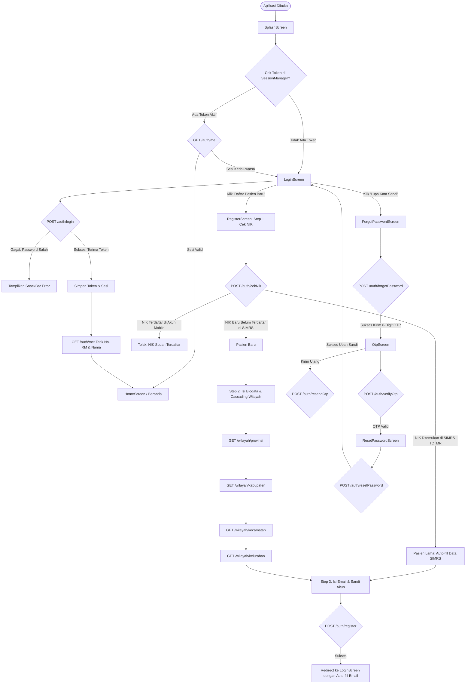

# Dokumentasi Integrasi API Backend SIMRS (Fitur Autentikasi & Registrasi)
Aplikasi Mobile Pasien RS PKU Muhammadiyah Gamping

Dokumen ini berisi rangkuman lengkap mengenai **arsitektur, alur kerja (*flow*), pemetaan endpoint, nomor baris, serta isi kodingan** untuk modul **Autentikasi (Splash, Login, Registrasi, Lupa Kata Sandi, dan OTP)**.

---

## 📑 Daftar Isi
1. [Diagram Alur Sistem (System Flowchart)](#-diagram-alur-sistem-system-flowchart)
2. [Tabel Ringkasan Endpoint API](#-tabel-ringkasan-endpoint-api)
3. [Rincian Implementasi per Layar (Screen)](#-rincian-implementasi-per-layar-screen)
   - [1. Halaman Splash (Auto-Login & Sesi)](#1-halaman-splash-libscreenssplash_screendart)
   - [2. Halaman Login (Autentikasi Akun & Tarik Profil Pasien)](#2-halaman-login-libscreenslogin_screendart)
   - [3. Halaman Registrasi (Cek NIK, Alur Pasien Baru vs Lama, Wilayah Cascading)](#3-halaman-registrasi-libscreensregister_screendart)
   - [4. Halaman Lupa Kata Sandi (Request OTP)](#4-halaman-lupa-kata-sandi-libscreensforgot_password_screendart)
   - [5. Halaman Verifikasi OTP (Validasi & Resend)](#5-halaman-verifikasi-otp-libscreensotp_screendart)
   - [6. Halaman Reset Password (Ubah Sandi Baru)](#6-halaman-reset-password-libscreensreset_password_screendart)
4. [File Pendukung (Service & Master Data)](#-file-pendukung)

---

## 🔄 Diagram Alur Sistem (System Flowchart)



---

## 📊 Tabel Ringkasan Endpoint API

| No | Endpoint API | Method | Halaman Pemanggil | Fungsi Utama |
| :---: | :--- | :---: | :--- | :--- |
| 1 | `/auth/me` | `GET` | `SplashScreen`, `LoginScreen` | Verifikasi status sesi token aktif dan mengambil profil rekam medis pasien (`FS_MR`, Nama, NIK). |
| 2 | `/auth/login` | `POST` | `LoginScreen` | Otentikasi email dan kata sandi, mengembalikan JWT token. |
| 3 | `/auth/cekNik` | `POST` | `RegisterScreen` (Langkah 1) | Cek apakah NIK sudah punya akun atau sudah terdaftar di database SIMRS (`TC_MR`). |
| 4 | `/wilayah/provinsi` | `GET` | `RegisterScreen` (Langkah 2) | Mengambil daftar seluruh provinsi di Indonesia dari SIMRS. |
| 5 | `/wilayah/kabupaten` | `GET` | `RegisterScreen` (Langkah 2) | Mengambil daftar kabupaten/kota berdasarkan `fs_kd_propinsi`. |
| 6 | `/wilayah/kecamatan` | `GET` | `RegisterScreen` (Langkah 2) | Mengambil daftar kecamatan berdasarkan `fs_kd_kabupaten`. |
| 7 | `/wilayah/kelurahan` | `GET` | `RegisterScreen` (Langkah 2) | Mengambil daftar kelurahan/desa berdasarkan `fs_kd_kecamatan`. |
| 8 | `/auth/register` | `POST` | `RegisterScreen` (Langkah 3) | Mendaftarkan akun login baru dan menautkan ke rekam medis (`TC_MR`). |
| 9 | `/auth/forgotPassword` | `POST` | `ForgotPasswordScreen` | Meminta pengiriman 6-digit kode OTP ke email pasien. |
| 10 | `/auth/verifyOtp` | `POST` | `OtpScreen` | Memvalidasi 6-digit kode OTP yang dimasukkan pasien. |
| 11 | `/auth/resendOtp` | `POST` | `OtpScreen` | Mengirim ulang kode OTP baru jika waktu countdown habis. |
| 12 | `/auth/resetPassword` | `POST` | `ResetPasswordScreen` | Mengubah kata sandi lama menjadi kata sandi baru. |

---

## 💻 Rincian Implementasi per Layar (Screen)

### 1. Halaman Splash: `lib/screens/splash_screen.dart`

* **Tujuan / Alur:**
  1. Memeriksa keberadaan token lokal di `SessionManager.token`.
  2. Jika ada token, aplikasi memanggil endpoint `GET /auth/me` melalui `SimrsService.checkSession()`.
  3. Jika sesi backend masih valid ➔ **langsung navigasi ke Beranda (`AppRoutes.home`)** tanpa meminta login ulang.
  4. Jika token tidak ada atau kedaluwarsa ➔ **navigasi ke Layar Login (`AppRoutes.login`)**.
* **Lokasi Baris:** `lib/screens/splash_screen.dart` (Baris 54–80)
* **Cuplikan Kodingan UI:**
```dart
    // Cek apakah ada sesi login aktif
    final token = SessionManager.token;
    final isLoggedIn = SessionManager.isLoggedIn;

    if (isLoggedIn && token != null && token.isNotEmpty) {
      try {
        final sessionData = await SimrsService.checkSession();
        if (!mounted) return;

        if (sessionData != null) {
          // Sesi masih valid di backend SIMRS -> langsung masuk ke Beranda
          Navigator.pushReplacementNamed(context, AppRoutes.home);
          return;
        }
      } catch (_) {
        if (mounted) {
          Navigator.pushReplacementNamed(context, AppRoutes.home);
          return;
        }
      }
    }

    if (mounted) {
      Navigator.pushReplacementNamed(context, AppRoutes.login);
    }
```
* **Implementasi Service:** `lib/services/simrs_service.dart` (Baris 115–157)
```dart
  static Future<Map<String, dynamic>?> checkSession() async {
    try {
      final response = await _dio.get('/auth/me');
      final data = response.data;
      if (data is Map<String, dynamic> && (data['status'] == true || data['status'] == 'success')) {
        final userData = (data['data'] ?? data['user']) as Map<String, dynamic>?;
        if (userData != null) {
          final simrsObj = userData['simrs'] as Map<String, dynamic>?;
          final nama = simrsObj?['FS_NM_PASIEN']?.toString() ??
              userData['fs_nm_pasien']?.toString() ??
              userData['nama']?.toString() ??
              SessionManager.namaPasien;
          final noRm = userData['fs_mr']?.toString() ??
              simrsObj?['FS_MR']?.toString() ??
              SessionManager.noRm;
          final nik = userData['fs_nik']?.toString() ??
              simrsObj?['FS_KD_IDENTITAS']?.toString() ??
              SessionManager.nik;

          await SessionManager.saveUser(
            name: nama,
            noRm: noRm,
            nik: nik,
            email: userData['fs_email']?.toString() ?? SessionManager.email,
          );
        }
        return data;
      }
      return null;
    } catch (e) {
      debugPrint('[SimrsService] checkSession error: $e');
      return null;
    }
  }
```

---

### 2. Halaman Login: `lib/screens/login_screen.dart`

* **Tujuan / Alur:**
  1. Menangkap argumen email dari halaman registrasi (`didChangeDependencies`), sehingga email otomatis terisi setelah registrasi selesai.
  2. Mengirimkan kredensial email & password ke `POST /auth/login`.
  3. Menerima JWT token dan menyimpannya ke `SessionManager`.
  4. Otomatis memicu `checkSession()` (`GET /auth/me`) untuk mengambil data No. Rekam Medis (`FS_MR`), NIK, dan Nama Pasien dari database SIMRS.
  5. Menampilkan SnackBar mengambang berwarna merah jika kredensial salah.
* **Lokasi Baris:** `lib/screens/login_screen.dart` (Baris 48–72 untuk tangkap argumen, Baris 92–142 untuk eksekusi login)
* **Cuplikan Kodingan UI:**
```dart
  // 1. Menangkap Email Otomatis setelah Selesai Mendaftar (Baris 48-72)
  @override
  void didChangeDependencies() {
    super.didChangeDependencies();
    if (!_didCheckArgs) {
      _didCheckArgs = true;
      final args = ModalRoute.of(context)?.settings.arguments;
      if (args is Map<String, dynamic>) {
        if (args['email'] != null) {
          _emailController.text = args['email'].toString();
        }
        if (args['message'] != null) {
          WidgetsBinding.instance.addPostFrameCallback((_) {
            if (mounted) {
              ScaffoldMessenger.of(context).showSnackBar(
                SnackBar(
                  content: Text(args['message'].toString()),
                  backgroundColor: AppColors.success,
                  behavior: SnackBarBehavior.floating,
                ),
              );
            }
          });
        }
      }
    }
  }

  // 2. Eksekusi Login via API (Baris 92-142)
  Future<void> _handleLogin() async {
    if (!_formKey.currentState!.validate()) return;
    setState(() => _isLoading = true);

    try {
      final res = await SimrsService.login(
        username: _emailController.text.trim(),
        password: _passwordController.text,
      );

      if (!mounted) return;

      final isSuccess = res['status'] == true ||
          res['status'] == 'success' ||
          res['status'] == 1 ||
          res['status'] == 200;

      if (!isSuccess) {
        throw Exception(res['message']?.toString() ?? 'Email atau kata sandi salah.');
      }

      if (!SessionManager.isLoggedIn) {
        throw Exception('Token login tidak berhasil disimpan.');
      }

      Navigator.pushReplacementNamed(
        context,
        AppRoutes.home,
        arguments: TopNotificationType.loginSuccess,
      );
    } catch (e) {
      if (!mounted) return;
      final msg = e.toString().replaceFirst('Exception: ', '');
      ScaffoldMessenger.of(context).showSnackBar(
        SnackBar(
          content: Text(msg),
          backgroundColor: AppColors.error,
          behavior: SnackBarBehavior.floating,
        ),
      );
    } finally {
      if (mounted) setState(() => _isLoading = false);
    }
  }
```
* **Implementasi Service:** `lib/services/simrs_service.dart` (Baris 17–46)
```dart
  static Future<Map<String, dynamic>> login({
    required String username,
    required String password,
  }) async {
    try {
      final response = await _dio.post(
        '/auth/login',
        data: {
          'fs_email': username,
          'fs_password': password,
          'username': username,
          'email': username,
          'password': password,
        },
      );

      final data = response.data is Map<String, dynamic>
          ? response.data as Map<String, dynamic>
          : <String, dynamic>{};

      if (data['status'] == false ||
          data['status'] == 0 ||
          data['status'] == 'failed' ||
          data['status'] == 'error') {
        final message = data['message']?.toString() ??
            'Email atau kata sandi salah. Silakan periksa kembali.';
        throw Exception(message);
      }

      // Simpan token ke SessionManager
      final token = data['token'] as String? ?? data['access_token'] as String?;
      if (token != null) {
        await SessionManager.saveToken(token);
      }

      // Ambil detail pasien SIMRS via /auth/me
      try {
        await checkSession();
      } catch (e) {
        debugPrint('[SimrsService] Sinkronisasi /auth/me setelah login: $e');
      }

      return data;
    } on DioException catch (e) { ... }
  }
```

---

### 3. Halaman Registrasi: `lib/screens/register_screen.dart`

Halaman ini mengelola formulir pendaftaran 3 langkah (*stepper*) dengan percabangan antara **Pasien Lama** dan **Pasien Baru**.

#### A. Cek NIK & Verifikasi SIMRS (`POST /auth/cekNik`)
* **Tujuan / Alur:** Pengguna memasukkan 16 digit NIK. Sistem memvalidasi apakah NIK sudah punya akun atau sudah tercatat di rekam medis SIMRS (`TC_MR`).
* **Lokasi Baris:** `lib/screens/register_screen.dart` (Baris 383–505)
* **Cuplikan Kodingan UI:**
```dart
  Future<bool> _cekNikAsync() async {
    final nik = _nikController.text.trim();
    if (nik.length != 16) return false;

    setState(() => _isNikChecking = true);

    try {
      final res = await SimrsService.verifyNik(nik);
      if (!mounted) return false;

      final isAlreadyRegistered = res['status'] == false;
      final simrsData = (res['data'] is Map<String, dynamic>)
          ? res['data'] as Map<String, dynamic>
          : (res['simrs'] is Map<String, dynamic>)
              ? res['simrs'] as Map<String, dynamic>
              : res;

      final mrFromSimrs = (simrsData['fs_mr'] ?? simrsData['FS_MR'])?.toString();
      final foundInSimrs = (res['found'] == true || (mrFromSimrs != null && mrFromSimrs.isNotEmpty));

      if (foundInSimrs && !isAlreadyRegistered) {
        _existingMr = mrFromSimrs;

        // Auto-fill identitas jika pasien lama di SIMRS
        _namaController.text = (simrsData['fs_nm_pasien'] ?? simrsData['FS_NM_PASIEN'] ?? '')?.toString();
        _selectedTempatLahir = (simrsData['fs_temp_lahir'] ?? simrsData['FS_TEMP_LAHIR'])?.toString();
        _selectedTanggalLahir = _tryParseDate(simrsData['fd_tgl_lahir'] ?? simrsData['FD_TGL_LAHIR']);
        _selectedJenisKelamin = _parseJenisKelamin(simrsData['fs_jns_kelamin'] ?? simrsData['FS_JNS_KELAMIN']);
        _alamatController.text = (simrsData['fs_alm_pasien'] ?? simrsData['FS_ALM_PASIEN'] ?? '')?.toString();
      } else if (!foundInSimrs) {
        _existingMr = null;
      }

      setState(() {
        _isNikChecking = false;
        _nikHasBeenChecked = true;
        _isNikAlreadyRegistered = isAlreadyRegistered;
        _isNikVerified = !isAlreadyRegistered;
      });

      return !isAlreadyRegistered;
    } catch (_) { ... }
  }
```

#### B. Percabangan Alur Pasien Lama vs Pasien Baru
* **Tujuan / Alur:**
  * **Pasien Lama** (punya No. RM di SIMRS) ➔ **Langkah 2 dilewati, langsung lompat ke Langkah 3 (Akun & Sandi)**. Tombol kembali di Langkah 3 langsung balik ke Langkah 1.
  * **Pasien Baru** (belum punya No. RM) ➔ Masuk ke **Langkah 2 untuk mengisi Biodata & Alamat Domisili**.
* **Lokasi Baris:** `lib/screens/register_screen.dart` (Baris 614–618 untuk navigasi maju, Baris 192–206 untuk tombol kembali)
* **Cuplikan Kodingan UI:**
```dart
    // Percabangan Lanjut (Baris 614-618)
    if (_existingMr != null && _existingMr!.isNotEmpty) {
      _goToPage(2); // Pasien Lama: Langsung lompat ke Langkah 3
    } else {
      _goToPage(1); // Pasien Baru: Ke Langkah 2 (Biodata & Alamat)
    }

    // Tombol Back Bertingkat (Baris 192-206)
    void _prevPage() {
      if (_currentPage == 2 && _existingMr != null && _existingMr!.isNotEmpty) {
        _goToPage(0); // Pasien Lama: dari Step 3 langsung kembali ke Step 1
      } else if (_currentPage > 0) {
        _goToPage(_currentPage - 1);
      } else {
        Navigator.pop(context);
      }
    }
```

#### C. Cascading Dropdown Wilayah Bertingkat (Langkah 2)
* **Tujuan / Alur:** Pengambilan data wilayah secara bertingkat:
  1. `GET /wilayah/provinsi` ➔ Pilih Provinsi
  2. `GET /wilayah/kabupaten?fs_kd_propinsi=...` ➔ Pilih Kabupaten
  3. `GET /wilayah/kecamatan?fs_kd_kabupaten=...` ➔ Pilih Kecamatan
  4. `GET /wilayah/kelurahan?fs_kd_kecamatan=...` ➔ Pilih Kelurahan
* **Lokasi Baris:** `lib/screens/register_screen.dart` (Baris 109–155)
* **Cuplikan Kodingan UI:**
```dart
  Future<void> _onProvinsiChanged(WilayahItem? item) async {
    setState(() {
      _selectedProvinsi = item;
      _selectedKabupaten = null;
      _selectedKecamatan = null;
      _selectedKelurahan = null;
      _kabupatenList = [];
      _kecamatanList = [];
      _kelurahanList = [];
    });
    if (item != null) {
      setState(() => _isLoadingWilayah = true);
      _kabupatenList = await WilayahService.getKabupaten(item.kode, item.nama);
      if (mounted) setState(() => _isLoadingWilayah = false);
    }
  }

  Future<void> _onKabupatenChanged(WilayahItem? item) async {
    setState(() {
      _selectedKabupaten = item;
      _selectedKecamatan = null;
      _selectedKelurahan = null;
      _kecamatanList = [];
      _kelurahanList = [];
    });
    if (item != null) {
      setState(() => _isLoadingWilayah = true);
      _kecamatanList = await WilayahService.getKecamatan(item.kode, item.nama);
      if (mounted) setState(() => _isLoadingWilayah = false);
    }
  }

  Future<void> _onKecamatanChanged(WilayahItem? item) async {
    setState(() {
      _selectedKecamatan = item;
      _selectedKelurahan = null;
      _kelurahanList = [];
    });
    if (item != null) {
      setState(() => _isLoadingWilayah = true);
      _kelurahanList = await WilayahService.getKelurahan(item.kode, item.nama);
      if (mounted) setState(() => _isLoadingWilayah = false);
    }
  }
```

#### D. Dropdown Reaktif di `RegisterStep2Pasien`
* **Lokasi Baris:** `lib/screens/register_widgets/register_step2_pasien.dart` (Baris 802–870)
* **Kodingan:** Menggunakan `initialValue: validItem` dan `ValueKey` dinamis agar FormField langsung me-rebuild dan mereset nilai saat provinsi/kabupaten berubah:
```dart
    final dropdownKey = ValueKey(
      '${hint}_${validItem?.kode ?? "empty"}_${items.length}_${items.isNotEmpty ? items.first.kode : "none"}',
    );

    return DropdownButtonFormField<WilayahItem>(
      key: dropdownKey,
      initialValue: validItem,
      onChanged: items.isEmpty ? null : onChanged,
      ...
```

#### E. Eksekusi Registrasi Akhir (`POST /auth/register`)
* **Tujuan / Alur:** Mengirimkan seluruh data form pasien, termasuk kode kelurahan 10-digit (`FS_KD_KELURAHAN`) dan nomor rekam medis (`fs_mr`) jika pasien lama.
* **Lokasi Baris:** `lib/screens/register_screen.dart` (Baris 801–828)
* **Cuplikan Kodingan UI:**
```dart
      final payload = {
        'fs_email': email,
        'fs_password': password,
        'fs_nik': _nikController.text.trim(),
        'fs_nm_pasien': namaPasien,
        'fs_no_hp': noHp,
        'fd_tgl_lahir': tglLahirStr,
        'fs_temp_lahir': _selectedTempatLahir ?? 'Sleman',
        'fs_jenis_kelamin': (_selectedJenisKelamin == 'Perempuan') ? '1' : '0',
        'fs_gol_darah': _selectedGolDarah ?? 'O',
        'fs_alamat': alamat,
        'fs_kd_agama': _mapAgamaToCode(_selectedAgama),
        'fs_kd_pekerjaan': _mapPekerjaanToCode(_selectedPekerjaan),
        'fs_kd_pendidikan': _mapPendidikanToCode(_selectedPendidikan),
        'fs_status_kawin': _mapStatusKawinToCode(_selectedStatusKawin),
        'fs_nm_ibu_kandung': namaIbu,
        'fs_warga_negara': (_selectedWargaNegara == 'WNA') ? '2' : '1',
        'fs_kd_suku': '004',
        'fs_kd_kelurahan': kdKelurahan,
        if (_existingMr != null && _existingMr!.isNotEmpty) 'fs_mr': _existingMr,
      };

      final res = await SimrsService.registerPasien(payload);

      if (res['status'] == false) {
        throw Exception(res['message']?.toString() ?? 'Gagal melakukan pendaftaran.');
      }
```

---

### 4. Halaman Lupa Kata Sandi: `lib/screens/forgot_password_screen.dart`

* **Tujuan / Alur:** Pasien memasukkan email akun yang terdaftar. Sistem memanggil `POST /auth/forgotPassword`. Backend membuat kode 6 digit OTP dan mengirimkannya ke email pasien.
* **Lokasi Baris:** `lib/screens/forgot_password_screen.dart` (Baris 49–65)
* **Cuplikan Kodingan UI:**
```dart
    try {
      final res = await SimrsService.forgotPassword(email);

      if (res['status'] == false) {
        throw Exception(res['message']?.toString() ?? 'Gagal mengirim kode OTP.');
      }

      Navigator.pushNamed(
        context,
        AppRoutes.otp,
        arguments: {'email': email},
      );
    } catch (e) {
      ScaffoldMessenger.of(context).showSnackBar(
        SnackBar(content: Text(e.toString()), backgroundColor: AppColors.error),
      );
    }
```
* **Implementasi Service:** `lib/services/simrs_service.dart` (Baris 341–363)
```dart
  static Future<Map<String, dynamic>> forgotPassword(String email) async {
    try {
      final response = await _dio.post(
        '/auth/forgotPassword',
        data: {'fs_email': email, 'email': email},
      );
      if (response.data is Map<String, dynamic>) {
        return response.data as Map<String, dynamic>;
      }
      return {'status': true, 'message': 'Kode OTP berhasil dikirim'};
    } on DioException catch (e) { ... }
  }
```

---

### 5. Halaman Verifikasi OTP: `lib/screens/otp_screen.dart`

#### A. Verifikasi Kode OTP 6 Digit (`POST /auth/verifyOtp`)
* **Tujuan / Alur:** Pengguna memasukkan 6 digit kode yang diterima dari email. Jika benar, aplikasi menerima `reset_token` dan diarahkan ke Layar Reset Password.
* **Lokasi Baris:** `lib/screens/otp_screen.dart` (Baris 131–148)
* **Cuplikan Kodingan UI:**
```dart
    try {
      final res = await SimrsService.verifyOtp(email: _email, otp: _otpCode);
      if (!mounted) return;

      if (res['status'] == false) {
        throw Exception(res['message']?.toString() ?? 'Kode OTP tidak valid atau sudah kedaluwarsa.');
      }

      Navigator.pushReplacementNamed(
        context,
        AppRoutes.resetPassword,
        arguments: {
          'email': _email,
          'reset_token': res['reset_token'] ?? res['token'],
        },
      );
    } catch (e) { ... }
```

#### B. Kirim Ulang OTP (`POST /auth/resendOtp`)
* **Tujuan / Alur:** Jika waktu hitung mundur (*countdown*) habis dan pengguna belum menerima email, tombol "Kirim Ulang" akan memanggil endpoint `POST /auth/resendOtp`.
* **Lokasi Baris:** `lib/screens/otp_screen.dart` (Baris 89–95)
* **Cuplikan Kodingan UI:**
```dart
    try {
      final res = await SimrsService.resendOtp(_email);
      if (res['status'] == false) {
        throw Exception(res['message']?.toString() ?? 'Gagal mengirim ulang kode OTP.');
      }
      if (!mounted) return;
      _startCountdown();
    } catch (e) { ... }
```

---

### 6. Halaman Reset Password: `lib/screens/reset_password_screen.dart`

* **Tujuan / Alur:** Pengguna memasukkan kata sandi baru dan konfirmasi sandi. Sistem mengirimkan sandi baru bersama `reset_token` ke endpoint `POST /auth/resetPassword`. Setelah berhasil, pengguna otomatis dikembalikan ke Layar Login dengan pesan sukses.
* **Lokasi Baris:** `lib/screens/reset_password_screen.dart` (Baris 113–133)
* **Cuplikan Kodingan UI:**
```dart
    try {
      final res = await SimrsService.resetPassword(
        email: _email!,
        password: _passwordController.text,
        resetToken: _resetToken,
      );

      if (!mounted) return;

      if (res['status'] == false) {
        throw Exception(res['message']?.toString() ?? 'Gagal mengatur ulang kata sandi.');
      }

      Navigator.pushNamedAndRemoveUntil(
        context,
        AppRoutes.login,
        (route) => false,
        arguments: {
          'email': _email,
          'message': 'Kata sandi berhasil diperbarui. Silakan masuk kembali.',
        },
      );
    } catch (e) { ... }
```
* **Implementasi Service:** `lib/services/simrs_service.dart` (Baris 424–459)
```dart
  static Future<Map<String, dynamic>> resetPassword({
    required String email,
    required String password,
    String? resetToken,
  }) async {
    try {
      final response = await _dio.post(
        '/auth/resetPassword',
        data: {
          'fs_email': email,
          'email': email,
          'fs_password': password,
          'password': password,
          if (resetToken != null && resetToken.isNotEmpty) ...{
            'fs_reset_token': resetToken,
            'reset_token': resetToken,
          },
        },
      );
      return response.data as Map<String, dynamic>;
    } on DioException catch (e) { ... }
  }
```

---

## 📂 File Pendukung

1. **`lib/services/simrs_service.dart`**
   Layanan terpusat untuk komunikasi autentikasi dengan server SIMRS PKU Gamping (Login, Cek Sesi, Verifikasi NIK, Registrasi, Lupa Sandi, OTP).
2. **`lib/services/wilayah_service.dart`**
   Layanan terpusat untuk fetch data wilayah bertingkat dari database SIMRS dengan parser Title Case otomatis.
3. **`lib/core/session/session_manager.dart`**
   Penyimpan sesi lokal terenkripsi (token JWT, data nama pasien, no rekam medis, NIK, dan email).
4. **`lib/core/network/api_client.dart`**
   Konfigurasi HTTP Client berbasis `Dio` (Base URL, Timeout, Interceptor Bearer Token otomatis, dan Logging).
5. **`lib/data/wilayah_data.dart`**
   Master data wilayah offline lengkap (mencakup DIY, Sleman, Bantul, Pagar Alam, Palembang, dll.) yang berfungsi sebagai safety fallback jika koneksi API sedang offline.
